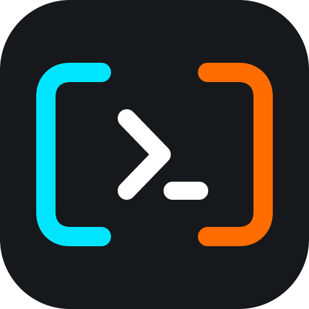
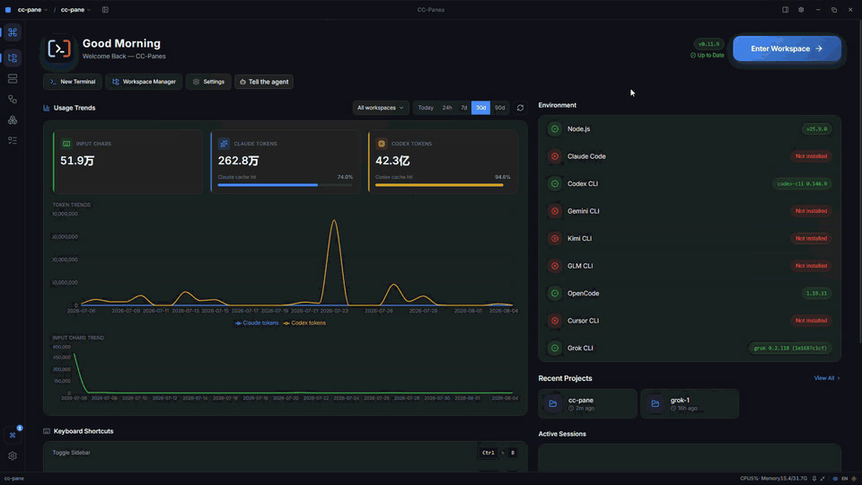
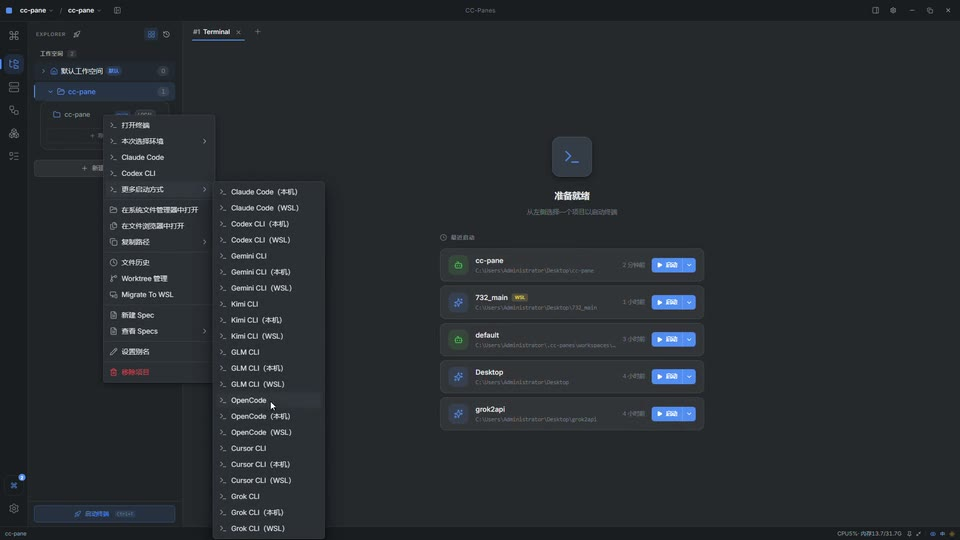
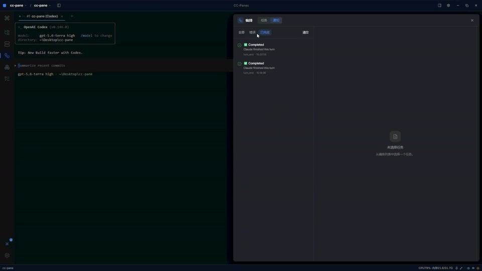
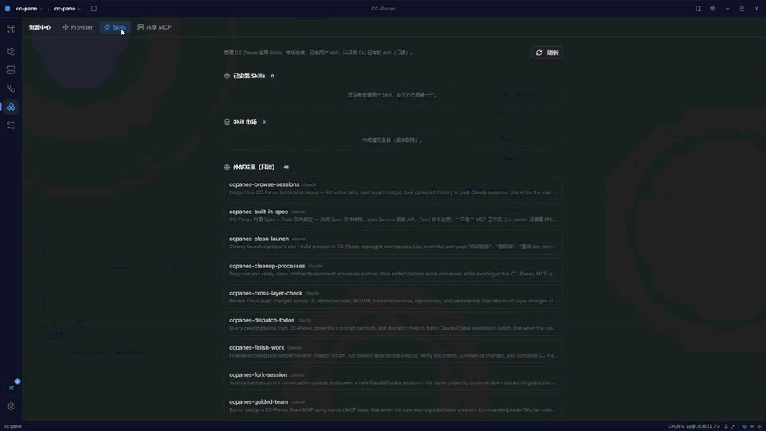

<h1 align="center">
  <a href="https://github.com/wuxiran/cc-pane"></a> CC-Panes
</h1>

<p align="center">
  <a href="https://github.com/wuxiran/cc-pane/releases/latest"></a>
  <a href="https://github.com/wuxiran/cc-pane/releases"></a>
  
  
</p>

<p align="center">
  <sub><a href="../../README.md">English</a> · <a href="README.zh-CN.md">中文</a> · <a href="README.ja.md">日本語</a> · <a href="README.ko.md">한국어</a> · <a href="README.es.md">Español</a> · <a href="README.fr.md">Français</a> · <a href="README.pt.md">Português</a> · <strong>Tiếng Việt</strong></sub>
</p>

<p align="center">
  <strong>Trung tâm chỉ huy trên máy tính cho lập trình AI song song.</strong><br />
  Chạy các CLI agent cạnh nhau, tổ chức không gian làm việc và phiên của chúng, rồi điều phối công việc thông qua MCP, kế hoạch, skill, Git và lịch sử cục bộ.
</p>

<p align="center">
  <a href="https://github.com/wuxiran/cc-pane/releases/latest"><b>Tải CC-Panes</b></a>
</p>

<p align="center">
  <a href="https://github.com/wuxiran/cc-pane/releases/latest"><picture><source srcset="../assets/readme-recordings/readme-hero.gif" type="image/gif" /></picture></a>
</p>

<sub>Các bản ghi sản phẩm bên dưới được ghi lại từ các tương tác thực tế trong ứng dụng desktop CC-Panes.</sub>

## Tính năng

<table>
<tr>
<td width="50%" valign="middle">

### Trung tâm chỉ huy không gian làm việc

Xem các phiên đang hoạt động, dự án gần đây, các CLI có sẵn, xu hướng sử dụng và ngữ cảnh không gian làm việc trong một giao diện desktop cục bộ. Di chuyển giữa không gian làm việc, dự án, tác vụ và terminal mà không bị mất mạch công việc.

[Xem hướng dẫn -&gt;](../guide/03-core-concepts.md)

</td>
<td width="50%">
  <a href="../guide/03-core-concepts.md"><picture><source srcset="../assets/readme-recordings/readme-hero.gif" type="image/gif" /></picture></a>
</td>
</tr>
<tr>
<td width="50%" valign="middle">

### Provider và hồ sơ khởi chạy

Chọn CLI, provider, bộ MCP, skill, runtime và chính sách quyền như một hồ sơ khởi chạy có thể dùng lại. Giữ các quy trình cục bộ, WSL và SSH dưới cùng một mô hình không gian làm việc.

[Hướng dẫn cài đặt -&gt;](../guide/10-settings.md)

</td>
<td width="50%">
  <a href="../guide/10-settings.md"><picture><source srcset="../assets/readme-recordings/provider-profiles.gif" type="image/gif" /></picture></a>
</td>
</tr>
<tr>
<td width="50%" valign="middle">

### Điều phối agent

Biến một tác vụ có phạm vi rõ ràng thành một lượt chạy được phối hợp. MCP `ccpanes` tích hợp sẵn cho phép một leader giao việc cho các worker, theo dõi tiến độ, thu thập kết quả và giữ kế hoạch cùng Todo gần với các phiên đang thực hiện công việc.

[Hướng dẫn điều phối MCP -&gt;](../guide/mcp-orchestration.md)

</td>
<td width="50%">
  <a href="../guide/mcp-orchestration.md"><picture><source srcset="../assets/readme-recordings/agent-orchestration.gif" type="image/gif" /></picture></a>
</td>
</tr>
<tr>
<td width="50%" valign="middle">

### Skill và công cụ dùng chung

Duyệt các quy trình có thể tái sử dụng, quản lý skill toàn cục và gắn các dịch vụ MCP dùng chung vào những hồ sơ cần đến chúng. CC-Panes cũng hiển thị các skill của CLI đã cài mà không ép chúng xuất hiện trong mọi phiên.

[Hướng dẫn về skill -&gt;](../guide/18-skills.md)

</td>
<td width="50%">
  <a href="../guide/18-skills.md"><picture><source srcset="../assets/readme-recordings/skills-and-mcp.gif" type="image/gif" /></picture></a>
</td>
</tr>
</table>

## Các CLI agent được hỗ trợ

| CLI | Nhà cung cấp | Lưu ý tích hợp |
| --- | --- | --- |
| **Claude Code** | Anthropic | Tự động phát hiện phiên, phân tích chi phí và token, gắn cờ cấu hình và tích hợp terminal. |
| **OpenCode** | Cộng đồng | Đầy đủ tính năng, hỗ trợ nhiều mô hình (DeepSeek, GLM, v.v.), tích hợp trình quản lý tệp và Git. |
| **Codex CLI** | OpenAI | Hồ sơ môi trường chuyên dụng, ghi nhật ký phiên và thực thi lệnh an toàn. |
| **Gemini CLI** | Google | Hỗ trợ mô hình Gemini 1.5/2.0, công cụ CLI và bộ nhớ ngữ cảnh lớn. |
| **Goose CLI** | Block | Tự động hóa nhà phát triển có thể mở rộng, bộ công cụ dựa trên tác vụ và hỗ trợ MCP phong phú. |
| **Aider** | Paul Gauthier | Lập trình theo cặp trên terminal, tự động commit Git và chỉnh sửa nhiều tệp mạnh mẽ. |

## Cài đặt

### Desktop - Windows, macOS, Linux

Tải xuống bản dựng đã phát hành cho nền tảng của bạn từ trang [Bản phát hành](https://github.com/wuxiran/cc-pane/releases/latest):

* **Windows:** Trình cài đặt `.exe` hoặc gói di động `.zip`
* **macOS:** `.dmg` (Hỗ trợ Apple Silicon & Intel)
* **Linux:** `.AppImage` hoặc gói `.deb`

### Lần khởi chạy đầu tiên

1. Mở CC-Panes và điều hướng đến tab **Cài đặt**.
2. CC-Panes sẽ tự động quét các CLI agent đã cài đặt trên máy của bạn (`claude`, `opencode`, `codex`, v.v.).
3. Nhấp vào **Không gian làm việc mới** để bắt đầu phiên lập trình đầu tiên của bạn!

## Cộng đồng và hỗ trợ

* Báo cáo sự cố hoặc đề xuất tính năng mới trên [GitHub Issues](https://github.com/wuxiran/cc-pane/issues).
* Tham gia thảo luận và kết nối với cộng đồng trên [GitHub Discussions](https://github.com/wuxiran/cc-pane/discussions).

## Phát triển

CC-Panes được xây dựng bằng [Tauri](https://tauri.app/), [Rust](https://www.rust-lang.org/) và [React](https://react.dev/).

```bash
# Cài đặt các gói phụ thuộc
pnpm install

# Chạy ở chế độ phát triển
pnpm tauri dev

# Xây dựng bản phát hành
pnpm tauri build
```

## Giấy phép

Dự án này được cấp phép theo các điều khoản của [Giấy phép Công cộng GNU phiên bản 3.0 (GPL-3.0)](../../LICENSE).

## Lời cảm ơn

Đặc biệt cảm ơn tất cả các tác giả và người đóng góp cho các công cụ CLI mã nguồn mở tuyệt vời đã truyền cảm hứng cho dự án này!
